<a href="https://www.linkedin.com/in/wiktor-stefaniak-4b9287279/">
  <picture>
    <source media="(prefers-color-scheme: dark)" srcset="assets/header-dark.svg">
    
  </picture>
</a>

  <a href="https://www.linkedin.com/in/wiktor-stefaniak-4b9287279/"><picture><source media="(prefers-color-scheme: dark)" srcset="assets/btn-linkedin-dark.svg"></picture></a>
  <a href="mailto:wikstef2@gmail.com"><picture><source media="(prefers-color-scheme: dark)" srcset="assets/btn-email-dark.svg"></picture></a>
  <a href="https://bifor.games"><picture><source media="(prefers-color-scheme: dark)" srcset="assets/btn-bifor-web-dark.svg"></picture></a>

<a href="https://www.linkedin.com/in/wiktor-stefaniak-4b9287279/">
  <picture>
    <source media="(prefers-color-scheme: dark)" srcset="assets/title-01-dark.svg">
    
  </picture>
</a>

<a href="https://www.linkedin.com/in/wiktor-stefaniak-4b9287279/">
  <picture>
    <source media="(prefers-color-scheme: dark)" srcset="assets/about-dark.svg">
    
  </picture>
</a>

<a href="https://bifor.games">
  <picture>
    <source media="(prefers-color-scheme: dark)" srcset="assets/title-02-dark.svg">
    
  </picture>
</a>

<a href="https://bifor.games">
  <picture>
    <source media="(prefers-color-scheme: dark)" srcset="assets/bifor-dark.svg">
    
  </picture>
</a>

  <a href="https://apps.apple.com/pl/app/id6788678207"><picture><source media="(prefers-color-scheme: dark)" srcset="assets/btn-appstore-dark.svg"></picture></a>
  <a href="https://play.google.com/store/apps/details?id=com.bifor.app"><picture><source media="(prefers-color-scheme: dark)" srcset="assets/btn-googleplay-dark.svg"></picture></a>

<a href="https://github.com/rvabka?tab=repositories">
  <picture>
    <source media="(prefers-color-scheme: dark)" srcset="assets/title-03-dark.svg">
    
  </picture>
</a>

<a href="https://github.com/rvabka?tab=repositories">
  <picture>
    <source media="(prefers-color-scheme: dark)" srcset="assets/stack-dark.svg">
    
  </picture>
</a>

&nbsp;

<a href="mailto:wikstef2@gmail.com">
  <picture>
    <source media="(prefers-color-scheme: dark)" srcset="assets/footer-dark.svg">
    
  </picture>
</a>
